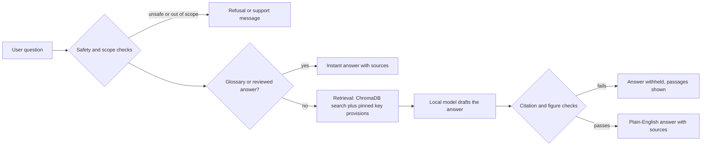

# Legal-AI: a private, plain-language legal information assistant for Nigeria

Legal-AI answers everyday legal questions in simple English, using only a library of Nigerian legal documents. Every answer shows the sections it relied on, and answers that the checks cannot support are withheld. The whole system runs on the user's own computer, so questions never leave the device.

> **Not legal advice.** Legal-AI gives general legal information only. It can be wrong. Always check the cited sections and speak to a qualified lawyer or the Legal Aid Council about your situation.

Developed by our team under the guidance of our facilitator, **Mr Stephen Ayuba**, with acknowledgement to the **National Centre for Artificial Intelligence and Robotics (NCAIR)**.

---

## Contents

1. [Why this project exists](#why-this-project-exists)
2. [Key features](#key-features)
3. [How it works](#how-it-works)
4. [Knowledge base](#knowledge-base)
5. [Technology](#technology)
6. [Getting started](#getting-started)
7. [Preparing the data](#preparing-the-data)
8. [Using the assistant](#using-the-assistant)
9. [Project structure](#project-structure)
10. [Configuration](#configuration)
11. [Testing and evaluation](#testing-and-evaluation)
12. [Performance](#performance)
13. [Safeguards](#safeguards)
14. [Known limitations](#known-limitations)
15. [Roadmap](#roadmap)
16. [Team](#team)
17. [Acknowledgements](#acknowledgements)
18. [References](#references)
19. [License](#license)

---

## Why this project exists

- The Legal Aid Council of Nigeria's Director-General has said that about **70% of Nigerians cannot afford legal representation** [1], and a BusinessDay report cites **81% facing at least one legal problem each year** [2].
- Legal aid is stretched. The Council has described funding, publicity and access to information as recurring constraints [3][4].
- Laws are long and technical, so even a person with access to the text can struggle to understand it.
- General-purpose AI chatbots are not a safe fix. A Stanford study found that even commercial legal research tools produced false or misleading answers between **17% and 33%** of the time [5].

Legal-AI tries to close part of this gap with a free assistant that explains the law in plain language, cites its sources, refuses what it cannot support, and keeps users' questions private.

## Key features

- **Plain-English answers** in a fixed format: a short answer, what the law says (with the section cited and explained), and what you can do next.
- **Source cards** under every answer showing the exact section text that was used.
- **"Explain section N of the Act"**: type for example *Explain section 72 of the Matrimonial Causes Act* and the assistant fetches that exact section and explains it.
- **Plain-English glossary**: about 36 common legal terms (bail, recognizance, intestate, notice to quit and more) answered instantly, without the language model.
- **Reviewed answers** for a few high-stakes questions (grounds for divorce and for judicial separation), written directly from the Act and returned instantly.
- **Key-provision pinning**: for questions where retrieval alone is unreliable (such as how long police may hold a person), the passage the answer depends on is always included.
- **Safety and scope checks**: it declines questions outside the documents' coverage, refuses messages that contain personal identifiers (for example a BVN), and responds supportively to crisis messages.
- **Answer verification**: citations must point to passages the model was actually given, invented figures are caught, and outcome predictions ("you will win") are blocked.
- **Topic picker and answer timer** in the interface.
- **Private by design**: no external API calls, and the query log stores counts and timings only, never the question text.

## How it works



**Stage 1: prepare the knowledge base (done once)**

1. Collect the legal documents and record them in `data/source_register.csv`.
2. Extract clean text from the PDFs and Word files.
3. Split each document at its numbered sections into short passages (about 1,500 characters at most), each labelled with its Act and section.
4. Turn each passage into numbers (an embedding) with `nomic-embed-text`.
5. Store everything in a ChromaDB index on disk.

**Stage 2: answer a question (every time)**

1. **Check.** Safety and scope checks run first. Crisis and privacy messages are handled here.
2. **Shortcuts.** Glossary terms and reviewed answers return immediately. A request such as "Explain section 72 of the Matrimonial Causes Act" fetches that section directly.
3. **Search.** Otherwise the question is matched against the index. Each relevant area of law is searched separately, legal wording is added to the search for common lay phrasings, and a few key provisions are always included for specific questions.
4. **Draft.** The local language model writes the answer from the retrieved passages only, following a structured prompt.
5. **Verify.** The answer is checked against the passages. If it fails, it is withheld and the passages are shown instead.
6. **Reply.** The answer is shown with its sources, a timer and the disclaimer.

## Knowledge base

21 documents were indexed at the time of writing (see `data/source_register.csv` for the authoritative list and status):

| Area | Documents |
|---|---|
| General | Constitution of the Federal Republic of Nigeria 1999 |
| Arrest and police | Administration of Criminal Justice Act 2015; Police Act 2020; Fundamental Rights (Enforcement Procedure) Rules 2009 |
| Employment | Labour Act (Cap L1); Employee Compensation Act 2010 |
| Land | Land Use Act 1978; Edo State High Court land judgments |
| Family and children | Matrimonial Causes Act (Cap M7); Marriage Act (Cap M6); FCT Customary Court Act 2007; Child's Rights Act 2003; article on customary marriage |
| Consumer and lending | Federal Competition and Consumer Protection Act 2018; FCCPC administrative penalties regulations 2020; CBN consumer protection regulations; DEON consumer lending guidelines 2025; digital lending regulations 2025 |
| Tenancy | Lagos State Tenancy Law 2011 (applies in Lagos State only) |

Documents that are deliberately **not** indexed: the Legal Aid Act text we hold is labelled as a bill and is waiting for the gazetted version; a project checklist that was mistaken for tenancy law; foreign or non-binding support documents; and drafts that are not in force.

## Technology

| Layer | Choice |
|---|---|
| Language | Python 3.12 |
| Interface | Streamlit |
| Language model | `llama3.2:3b` (quantized build served by Ollama), running locally on CPU |
| Embeddings | `nomic-embed-text` via Ollama |
| Vector store | ChromaDB (persistent, on disk) |
| Text extraction | PyMuPDF (plus layout-aware tools for awkward PDFs) |
| Testing | pytest and our own evaluation scripts |

Nothing in the answer path calls an external service.

## Getting started

### Prerequisites

- Python 3.10 or newer (developed on 3.12)
- [Ollama](https://ollama.com) installed and running
- About 8 GB of free RAM (16 GB recommended) and 5 GB of disk space

### Install

```powershell
git clone https://github.com/lxffyhatescodes/LegalAidGPT
cd legal-aid-assistant

python -m venv .venv
.venv\Scripts\Activate.ps1          # Linux or macOS: source .venv/bin/activate

pip install streamlit chromadb ollama pymupdf pandas pytest
# or: pip install -r requirements.txt

ollama pull llama3.2:3b
ollama pull nomic-embed-text
```

### Run the app

Build the search index first (see [Preparing the data](#preparing-the-data)), then:

```powershell
streamlit run ui/app.py
```

Ask one throwaway question first so the models load into memory.

## Preparing the data

The built index (`data/index/`) is not stored in git. Build it locally:

1. Put each source file in `data/raw/`.
2. Add a row for it to `data/source_register.csv` (columns: `doc_id, title, file, problem_area, doc_type, status, source_url, date_downloaded, canonical, notes`). A status that starts with `excluded`, or equals `needs_ocr`, `draft_not_in_force` or `bill_text_verify`, keeps a document out of the index.
3. Extract and clean the text:

   ```powershell
   python ingest/extract.py
   ```

   The result is one file per document in `data/clean/`, with each numbered section on its own line. Check `data/clean/_report.csv` for flags.
4. Build the index:

   ```powershell
   python ingest/build_index.py                      # everything
   python ingest/build_index.py --areas employment   # only some areas
   ```

   Re-running is safe: existing passages are updated, not duplicated. If you change how passages are split, clear `data/index/chroma` first.
5. To remove a document from the index: `python scripts/remove_doc.py <doc_id>`.

## Using the assistant

Examples that the system handles:

| You ask | What happens |
|---|---|
| *What must police tell me when they arrest me?* | Cites ACJA section 6 and explains your rights on arrest |
| *How long can police hold me before taking me to court?* | States the one-day or two-day rule in the Constitution, section 35 |
| *My boss has not paid me for three months* | Cites the Labour Act on when wages are due |
| *Explain section 72 of the Matrimonial Causes Act* | Fetches the section and explains it |
| *What does bail mean?* | Instant plain-English definition |
| *What are the grounds for divorce?* | Instant reviewed answer listing the eight facts in section 15 |
| *What is the penalty for tax evasion?* | Declined: outside the covered documents |

Command-line use, without the interface:

```powershell
python scripts/ask_cli.py "What must police tell me when they arrest me?"
```

## Project structure

```
legal-aid-assistant/
├── assistant/
│   ├── config.py              settings (models, thresholds, paths, topic list)
│   ├── pipeline.py            main entry point called by the interface: ask()
│   ├── guidance_pipeline.py   checks, retrieval, drafting and verification flow
│   ├── guidance_modes.py      question types and topic detection
│   ├── guardrails.py          safety, privacy, scope and crisis checks
│   ├── citation_validator.py  checks that citations and figures match the passages
│   ├── llm.py                 prompt and calls to the local model
│   ├── glossary.py            plain-English glossary (instant answers)
│   └── curated.py             reviewed answers for a few high-stakes questions
├── retrieval/
│   ├── __init__.py            ChromaDB index and search
│   └── embeddings.py          embeddings through Ollama
├── ingest/                    document preparation: extract, organise, build index
├── ui/                        Streamlit interface (app.py, styles)
├── scripts/                   command-line tools (ask, preflight, evaluate, debugging)
├── tests/                     automated tests for checks, modes and pipeline
└── data/
    ├── source_register.csv    the list and status of every document
    ├── raw/                   original files
    ├── clean/                 extracted text
    ├── index/                 ChromaDB index (built locally, not in git)
    └── eval/                  evaluation questions and reports
```

## Configuration

The main settings are in `assistant/config.py`:

| Setting | Meaning |
|---|---|
| `OLLAMA_MODEL` | The answer model (default `llama3.2:3b`) |
| `EMBEDDING_MODEL` | The embedding model (`nomic-embed-text`) |
| `TOP_K` | How many passages are sent to the model |
| `MIN_SIMILARITY` | How close a passage must be to the question to be used |
| `LLM_MAX_NEW_TOKENS` | The longest answer the model may write, in tokens |
| `LLM_CONTEXT_TOKENS` | The model's working window, in tokens |
| `LLM_TEMPERATURE` | Set to 0 so answers are repeatable |
| `SHOW_UNVERIFIED_ANSWERS` | Keep `False`: unverified answers are withheld |
| `TOPICS`, `SAMPLE_QUESTIONS` | The topic picker and the example questions in the interface |

## Testing and evaluation

```powershell
python -m pytest tests                  # unit tests for the checks and modes
python scripts/preflight.py             # a quick end-to-end check of seven key questions
python scripts/evaluate.py --fast       # instant evaluation questions (about a minute)
python scripts/evaluate.py              # full evaluation (about 20 to 30 minutes)
python scripts/evaluate.py --model <name> --tag <label>    # compare another model
```

`data/eval/eval_questions.csv` holds 31 questions across arrest, employment, land, consumer and lending, family, explain-a-section, glossary, reviewed answers, out-of-scope, unsafe input and a coverage-gap case. For each one the script records the behaviour, whether the expected source was cited, whether the key facts appeared, the answer's structure and the time taken, and writes `data/eval/eval_results.csv` and `data/eval/eval_report.md`. Two manual columns are included for a human to judge correctness and plain-language quality.

Scenarios we tested by hand during development:

| Scenario | Status |
|---|---|
| Arrest rights (cites ACJA section 6) | Verified |
| Detention limit (one-day or two-day rule) | Verified |
| Divorce and property (cites section 72) | Partial: an irrelevant section can also be pulled in |
| Unpaid wages (cites the Labour Act) | Verified |
| Explain a section | Verified |
| Explain a term | Verified |
| Grounds for divorce | Verified |
| Out of scope | Verified |
| Unsafe input (personal identifiers, crisis message) | Verified |

"Verified" means observed in our own runs. The automatic checks measure behaviour, citation and key facts; they cannot judge legal correctness, so the answers need review by a lawyer. We have not yet measured an overall accuracy percentage.

## Performance

Speed depends heavily on the machine. On our development laptop (Intel Core i5-6200U, 16 GB RAM, no GPU), an answer from the language model takes roughly **40 to 120 seconds**. Glossary, reviewed and section-lookup answers and all refusals return in about a second. A GPU, a newer CPU or a hosted model would be much faster. The quantized 3B model was chosen because larger models were too slow on this hardware.

## Safeguards

- **Scope check.** Questions that match no covered topic are declined instead of answered from unrelated text.
- **Privacy.** Messages containing personal identifiers (such as BVN or NIN numbers) are refused, and the interface warns users not to enter them.
- **Crisis messages.** These receive a supportive response before anything else runs.
- **Grounding.** The model is told to use only the supplied passages and not to add facts, figures or definitions.
- **Verification.** Citations must match the passages provided, invented figures are flagged, and outcome predictions are blocked. Answers that fail are withheld.
- **Transparency.** Every answer lists its sources, shows the exact text, and ends with a not-legal-advice notice.

## Known limitations

- A small local model can misread a section or cite an irrelevant one. The checks reduce this but cannot remove it.
- Retrieval matches meaning, not coverage, so a document that is close in wording but wrong for the question can be retrieved.
- Tenancy answers cover **Lagos State only**; the Law also exempts some areas (Apapa, Ikeja GRA, Ikoyi, Victoria Island).
- Schedules attached to an Act can reuse section numbers, so a passage from a schedule may be labelled as a section.
- Coverage is limited to the indexed documents; many areas of law and other states' laws are missing.
- The glossary and reviewed answers are drafts written by the team and need review by a lawyer.
- Answers are slow on modest hardware.
- English only for now.

## Roadmap

Following feedback from our facilitator and the review panel:

1. **Multilingual support with N-ATLAS.** N-ATLAS is Nigeria's open-source multilingual language model, developed by NCAIR with Awarri Technologies, with support for Yoruba, Hausa, Igbo and Nigerian-accented English [6][7]. The plan is to translate a user's question into English, run the existing pipeline, and translate the answer back, keeping the English text and citations visible. Points to check first: the model is built on an 8B Llama base, so it will be heavier than our current model on CPU; access on Hugging Face requires accepting its terms and licence conditions; and its published human evaluation shows weaker results for Yoruba than for Hausa, so translations of legal text must be checked by native speakers.
2. **Wider document scope.** More states' tenancy laws, the gazetted Legal Aid Act, more statutes and regulations, a document-status indicator and a jurisdiction indicator in answers.
3. **Explain whole documents.** Let a user paste a tenancy agreement, letter or court notice and receive a plain-English explanation.
4. **More reviewed answers and glossary terms**, written with lawyers, for the questions people ask most.
5. **Lawyer review** of the glossary, reviewed answers and a sample of generated answers.
6. **Speed.** Benchmark other quantized models, support a GPU or hosted option, and use smaller passages.
7. **Stronger evaluation.** An independent question set written by people who have not seen the answers, with an accuracy rate and a manual rating of plain-language quality.
8. **Retrieval improvements.** Label schedule items correctly and balance search results across Acts.

## Team

| Role | Member      |
|---|-------------|
| Data sources and register | Mahmud Sani |
| Text extraction | Mahmud Sani |
| Passages and index | Maryam Bawa |
| Search and retrieval | Maryam Bawa |
| Prompt and model | Joseph Loveday |
| Guidance modes and guardrails | Rhema Kings |
| Backend and integration | Abdussabur Ibrahim |
| User interface | Samuel Fitto |
| Testing and evaluation | Abdulrrahman Bilyaminu |
| Documentation and presentation | Justice Akugbe |

**Facilitator:** Mr Stephen Ayuba

## Acknowledgements

We thank the **National Centre for Artificial Intelligence and Robotics (NCAIR)** and our facilitator, **Mr Stephen Ayuba**, for guidance, feedback and support throughout the project.

This project builds on open-source work: [Ollama](https://ollama.com), Meta's Llama 3.2 (used under the Llama 3.2 Community License), `nomic-embed-text`, [ChromaDB](https://www.trychroma.com), [Streamlit](https://streamlit.io) and [PyMuPDF](https://pymupdf.readthedocs.io).

## References

1. Political Economist (2025, 17 June). *70% Nigerians can't afford legal representation – LACON.* https://www.politicaleconomistng.com/?p=193715
2. BusinessDay (Nigeria). Commentary on the Legal Aid LL.M Fellowship. https://businessday.ng/?p=955146
3. The Guardian (Nigeria). *Legal Aid Council and challenges of fulfilling its mandate.* https://guardian.ng/?p=1656575
4. The Guardian (Nigeria). *Police Force Order 20 makes it compulsory for any lawyer to have free access to client in police detention.* https://guardian.ng/features/law/police-force-order-20-makes-it-compulsory-for-any-lawyer-to-have-free-access-to-client-in-police-detention/
5. Magesh, V. et al. (2025). Hallucination-free? Assessing the reliability of leading AI legal research tools. *Journal of Empirical Legal Studies.* https://doi.org/10.1111/jels.12413
6. TechCabal (2025, 25 September). *Nigerian government and Awarri launch N-ATLAS.* https://techcabal.com/2025/09/25/nigerian-government-awarri-launch-n-atlas/
7. NCAIR. *N-ATLaS model card.* Hugging Face. https://huggingface.co/NCAIR1/N-ATLaS
8. Lewis, P. et al. (2020). Retrieval-augmented generation for knowledge-intensive NLP tasks. *NeurIPS.* https://arxiv.org/abs/2005.11401 (the retrieval-augmented approach this system follows)

## License

No license has been chosen yet. Until one is added, all rights are reserved by the authors. The legal texts in `data/` are public documents, but check each source's terms before redistributing them. Llama 3.2 and any N-ATLAS model are subject to their own licences.

---

*Legal-AI provides general legal information, not legal advice. In an emergency, contact the emergency services. If you have been arrested or detained, ask to speak to a lawyer or a legal aid office as soon as you can.*
